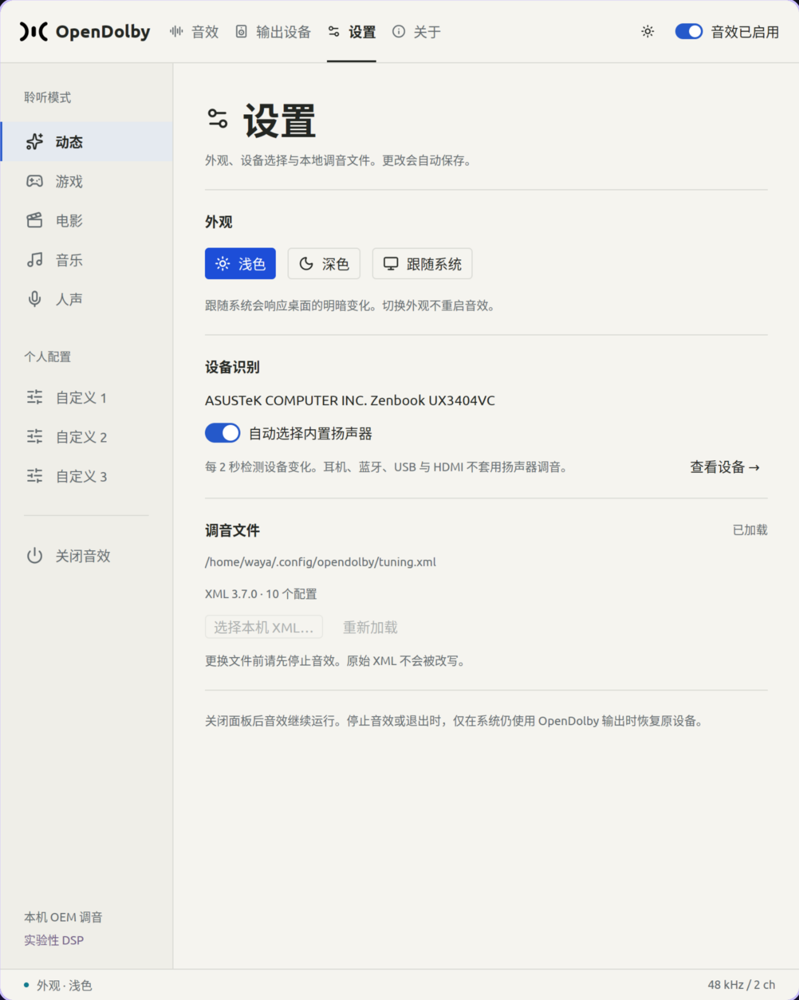

<div align="center">
  
  <p>面向 Linux PipeWire 的实验性扬声器 DSP 引擎与 GPUI-Kit 原生控制面板</p>
  <p>
    
    
    
    
  </p>
</div>

> **实验性声明**：本项目基于本机硬件调音 XML 进行净室（Clean-room）工程实现，**不是**杜比官方软件、**不是** Dolby Atmos 解码器，也不保证与 Windows APO 逐比特一致。源码尚未指定开源协议，请勿将其视为官方或认证实现。

## 界面预览

<div align="center">
  
</div>

## 核心能力

- **预设与实时切换**：主界面展示动态、游戏、电影、音乐、人声、三组自定义，以及关闭音效，支持实时切换与基准重置（Reset to baseline）。引擎仍可读取 XML 中全部 10 个配置，其中额外的 `voice_onlinecourse` 仅可通过 CLI 的 `--profile voice_onlinecourse` 使用，不放入参考布局的侧栏。
- **实时空间与对白调节**：提供 `Surround` 与 `Dialog` 平滑增益滑块（`0.0` ~ `2.0`，`1.0` 为当前预设近似基准；若 XML 禁用对应效果则滑块不会强行开启）。空间声场采用 M/S 展宽与延时交叉馈送，而非基于对象的 Atmos 渲染。
- **电平匹配 A/B 对比（Processed / Bypass）**：通过同一虚拟 Sink 并行运行两条路径，切换时进行 20 ms 交叉淡变。默认开启近似电学 RMS 匹配（仅通过衰减对齐较安静的一侧，需 1–2 秒稳定；并非响度/LUFS 标准化）。
- **Off 直通模式**：独立的纯平直通，不保留扬声器保护 DSP（笔记本扬声器请勿用于高音量低频测试）。
- **后台处理与输出路由**：在 **Output Devices / 输出设备** 页面选择虚拟输出，物理输出固定指向本机扬声器以避免自环。关闭面板继续处理，重新打开复用同一实例；主动停止引擎时才恢复默认扬声器。

## 依赖与构建

### 系统依赖

构建与运行原生 GUI 需要图形会话与可用的 Vulkan 驱动（详见 [GPUI-Kit Linux 安装文档](https://github.com/longbridge/gpui-kit/blob/main/website/docs/installation.md)）：

- **Fedora**:
  ```sh
  sudo dnf install gcc gcc-c++ clang pkg-config pipewire-devel fontconfig-devel wayland-devel libxkbcommon-x11-devel libX11-devel libxcb-devel openssl-devel libzstd-devel vulkan-loader
  ```
- **Ubuntu / Debian**（参照上游依赖整理，尚未在干净的 Ubuntu 机器上实测验证）:
  ```sh
  sudo apt install gcc g++ clang pkg-config libpipewire-0.3-dev libfontconfig-dev libwayland-dev libxkbcommon-x11-dev libx11-xcb-dev libssl-dev libzstd-dev libvulkan1
  ```

### 编译与运行

```sh
cargo build --release --locked --bins
./target/release/dolby-gui
```

首次启动 GUI 后引擎默认处于停止状态；点击启动后，前往 **Output Devices / 输出设备** 页面将系统输出切换至虚拟设备即可生效。

**关闭窗口不等于停止音效**：引擎启用时关闭面板，音频处理与输出路由会继续在后台运行。再次点击桌面图标或运行 `dolby-gui`，会重新打开同一实例，保留所选模式与实时调节。需要停用时，主动关闭面板中的 **启用音效** 开关，随后关闭窗口即可退出。也可以从终端控制同一个后台实例：

```sh
dolby-gui --status  # 查看后台实例、引擎状态与当前模式（JSON）
dolby-gui --start   # 启动音频引擎，没有实例时打开面板并启动
dolby-gui --stop    # 停止引擎并移除虚拟输出
dolby-gui --quit    # 停止引擎并退出整个后台实例
```

单实例通信仅限本用户，使用私有运行目录与 Unix socket，不开启网络端口。

### 可选：安装桌面入口

```sh
install -Dm755 target/release/dolby-gui "$HOME/.local/bin/dolby-gui"
install -Dm644 assets/dolby-gui.desktop "$HOME/.local/share/applications/dolby-gui.desktop"
install -Dm644 assets/opendolby-app.svg "$HOME/.local/share/icons/hicolor/scalable/apps/opendolby-app.svg"
```

请确保 `$HOME/.local/bin` 在 `PATH` 中。桌面启动器与音量面板共用同一个图标名，应用内使用保留相同比例和留白的透明标识。

### 自定义调音 XML

本项目**不捆绑、也不分发**任何 OEM 驱动或调音 XML 文件。GUI 与 CLI 共用统一的配置发现顺序：

1. 命令行参数 `--xml PATH`（优先级最高）
2. 环境变量 `OPENDOLBY_XML`
3. `$XDG_CONFIG_HOME/opendolby/tuning.xml` 或 `$HOME/.config/opendolby/tuning.xml`

```sh
# GUI 指定 XML
./target/release/dolby-gui --xml /path/to/tuning.xml

# CLI 指定 XML
./target/release/dolby-rs --xml /path/to/tuning.xml process-wav input.wav wet.wav --profile dynamic
./target/release/dolby-rs --xml /path/to/tuning.xml process-wav input.wav dry.wav --profile dynamic --bypass
./target/release/dolby-rs --xml /path/to/tuning.xml process-wav input.wav unaligned.wav --profile dynamic --no-level-match
```

## 常见音频恢复

如果异常退出导致系统仍停留在虚拟输出设备，可任选以下方式恢复物理扬声器：

1. 重新打开 `dolby-gui` 并点击停止引擎（若当前选中虚拟输出，会自动切回物理扬声器）。
2. 使用 PipeWire / WirePlumber 命令手动切回默认 Sink：
   ```sh
   wpctl status
   wpctl set-default <物理扬声器 Sink ID>
   ```

## 界面与图标设计约定

- **布局参考**：参考 Dolby Access 设置页的层级结构（顶部导航 + 左侧聆听模式 + 右侧当前场景设置），采用深色背景与克制的青色选中态，纯 GPUI-Kit 原生渲染，不嵌入网页视图（非官方实现）。
- **界面图标**：统一使用 [Lucide](https://lucide.dev/) 线性图标，SVG 与上游许可（`assets/icons/LICENSE`）均通过 `include_bytes!` 嵌入可执行文件，完全离线且不依赖当前工作目录。
- **项目标识**：采用极简几何的独立 OpenDolby 标识（[assets/opendolby.svg](assets/opendolby.svg) 与 [assets/opendolby.png](assets/opendolby.png)），桌面入口与 PipeWire 音频流统一使用 `opendolby-app` 图标名（方形图标见 [assets/opendolby-app.svg](assets/opendolby-app.svg)），不使用杜比官方双 D 标识。
- **功能边界**：仅展示实际可用的引擎控制项，不虚构未实现的均衡器、Atmos 解码或声学认证能力。

## DSP 实现说明与可复现验证

<details>
<summary>DSP 拟合与线程模型说明（展开查看）</summary>

- **20 段目标拟合**：不再将 20 段目标直接级联为重叠峰值滤波器，而是在 XML 实际非均匀频点处拟合**组合级联响应**（原型 `Q = 4.3` 为工程选择，非逆向还原的杜比常数）。采用解析 RBJ 二阶滤波器响应并在控制线程迭代，频点间行为与相位仍为近似。
- **IEQ 与保护限制**：IEQ 仍为静态目标近似，而非内容自适应专有算法；OEM PEQ / 高通与现有电平/压缩器保留，但压缩器参数语义、分频叠加与未使用的调节器字段尚未对照 Windows APO 抓包验证。通用输出限幅器不能替代原厂声学保护。
- **PipeWire 调度**：流回调当前在 PipeWire 主循环上串行执行（未使用 `RT_PROCESS`），配合有界立体声缓冲与原子实时控制，避免跨线程 `Arc<RefCell<_>>` 共享，但**并非硬实时认证引擎**。快速对比请使用 A/B 开关，避免频繁切换预设导致 DSP 状态重置。

</details>

<details>
<summary>本地验证条件与实测数值（2026-11-18，ALC294 / 0x10431693）</summary>

```sh
cargo test --all-targets
python3 tools/measure_dsp.py --label after --check-matching
# 请先停止 GUI 引擎；仅使用临时静音 null sink：
python3 tools/smoke_pipewire.py
```

- `cargo test --all-targets --locked`：19 项测试通过（含变长块大小、实时非法值处理、Off 精确直通与匹配 A/B）。
- **离线匹配测量**（`tools/measure_dsp.py`，需 NumPy / SciPy）：8 秒 48 kHz 立体声带限噪声（约 `-29.12 dBFS`）。旧版 Dynamic 输出比输入高 `+17.05 dB RMS`；开启匹配并稳定后，Dynamic / Music / Movie 湿声与旁路差值均小于 `0.001 dB`（仅代表特定信号的电学测量，不代表任意音乐的感知等响度）。
- **PipeWire 冒烟测试**（`tools/smoke_pipewire.py`）：在临时静音 null sink 捕获 `240000` 帧 48 kHz 立体声，单声道 RMS 约 `0.00360`，输出有限且 1–4 秒区间无 100 ms 静音块；默认硬件扬声器未受影响，未播放测试音。已安装的 PipeWire `1.6.11` 中 `pw-record` 在达到采样数上限时可能返回 `1`，测试脚本仅在错误日志为空且帧数精确匹配时放行并校验样本与路由。

</details>

## 许可与致谢

- **项目源码**：当前仓库未指定开源许可证。
- **第三方图标**：捆绑的 Lucide SVG 图标依据 ISC / MIT 协议使用，完整许可文本见 [assets/icons/LICENSE](assets/icons/LICENSE)。
- **参考资料**：W3C Audio EQ Cookbook (Robert Bristow-Johnson)、GPUI-Kit `Slider`/`SliderState` API、PipeWire 流与缓冲 API。
