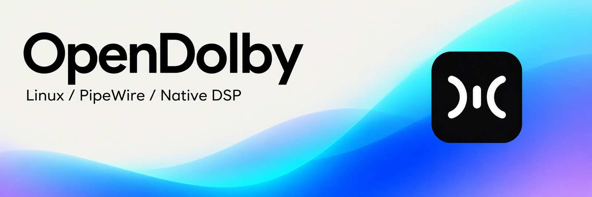
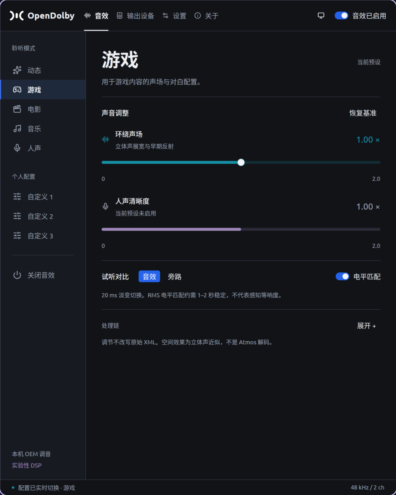

<div align="center">
  
  <h1>OpenDolby</h1>
  <p><strong>把本机调音，带回 Linux。</strong><br/>面向 Linux PipeWire 的实验性 Rust DSP 引擎与 GPUI-Kit 原生控制面板</p>
</div>

> [!WARNING]
> **实验性项目声明**：OpenDolby 基于本机硬件调音 XML 进行净室（Clean-room）工程实现，**不是**杜比官方软件、**不是** Dolby Atmos 解码器，也不保证与 Windows APO 逐比特一致。源码采用 `MIT OR Apache-2.0` 双许可开源，请勿将其视为官方或认证实现。

---

## 为什么做 OpenDolby

许多笔记本出厂时在 Windows 下配有针对内置扬声器的 OEM 声学调音（EQ、限幅与空间增强），切换到 Linux 后往往只剩干瘪的直通输出。OpenDolby 希望用轻量、本地优先的原生 Rust 方案，在不依赖网页视图或专有运行时的前提下，把这套调音能力带回 Linux PipeWire 桌面。

- **原生轻量**：纯 Rust DSP 引擎搭配 GPUI-Kit 原生界面，无 Electron 或浏览器内核开销。
- **后台单实例**：关闭窗口后音频处理与路由继续在后台运行，重开面板直接复用同一实例，也支持终端 CLI 控制。
- **克制的设备绑定**：基于 `pactl` 结构化设备发现，区分内置扬声器（UCM / `analog-output-speaker`）与耳机、USB、蓝牙、HDMI 及虚拟设备，仅对明确可用的内置扬声器自动套用本机 OEM 调音，不向任意声卡通用套用。

## 界面预览

<div align="center">
  
  
</div>

## 核心功能

- **预设与平滑切换**：支持动态、游戏、电影、音乐、人声、三组自定义及关闭音效，切换预设时执行 20 ms 无爆音交叉淡变，并支持基准重置（Reset to baseline）。引擎可读取 XML 中全部 10 个配置，额外的 `voice_onlinecourse` 可通过 CLI `--profile voice_onlinecourse` 启用。
- **实时空间与对白调节**：提供 `Surround` 与 `Dialog` 平滑增益滑块（`0.0` ~ `2.0`，`1.0` 为当前预设近似基准；若 XML 禁用对应效果则滑块不会强行开启）。空间声场采用 M/S 展宽与延时交叉馈送，而非基于对象的 Atmos 渲染。
- **电平匹配 A/B 对比（Processed / Bypass）**：在同一虚拟 Sink（`OpenDolby Speaker` / `opendolby_speaker`）内并行运行两条路径，切换时执行 20 ms 交叉淡变。默认开启近似电学 RMS 匹配（仅通过衰减对齐较安静的一侧，约需 1–2 秒稳定，并非响度/LUFS 标准化）。
- **Off 直通模式**：独立的纯平直通，**不保留扬声器保护 DSP**（笔记本内置扬声器请勿用于高音量低频测试）。
- **设备发现与安全路由**：在 **Output Devices / 输出设备** 页面查看设备状态、切换虚拟输出并支持安全恢复原默认输出；启动与运行时每 2 秒自动识别设备并仅选定安全内置扬声器目标（自动对齐 44.1 / 48 kHz 采样率），不会自动给耳机、USB、蓝牙或 HDMI 设备套用扬声器调音。单实例通信仅限本用户私有目录与 Unix socket，不开启网络端口。
- **设置页与完整偏好持久化**：在 **Settings / 设置** 页面切换浅色、深色或跟随系统主题，并通过原生文件选择器选取或重载本机调音 XML（引擎运行时需先停止再切换/重载）；主题、设备策略、XML 路径以及当前预设、`Surround`/`Dialog` 滑块与电平匹配状态均自动保存至 `~/.config/opendolby/ui.json`（遵循 `XDG_CONFIG_HOME`）。

## 硬件兼容性

OpenDolby 仅支持 **Linux + PipeWire**，**不支持** macOS 或 Windows。

| 品牌 / 机型 | 编解码器 / Subsystem | 发行版 | 状态 | 说明 |
| --- | --- | --- | --- | --- |
| ASUS Zenbook UX3404VC | Realtek ALC294 (`0x10431693`) | Fedora (PipeWire) | 已实测通过 | 实机验证主路径、A/B 电平匹配、后台单实例与路由恢复 |
| 其他机型 | 标准 OEM 调音 XML | Linux (PipeWire) | 仅解析逻辑支持 | 需本机 XML 与实机测试验证，不代表开箱支持 |

完整支持边界、社区借鉴说明与测试反馈清单见 [docs/compatibility.md](docs/compatibility.md)。

## 安装与使用

### 系统依赖

构建与运行原生 GUI 需要图形会话、可用的 Vulkan 驱动（详见 [GPUI-Kit Linux 安装文档](https://github.com/longbridge/gpui-kit/blob/main/website/docs/installation.md)），以及用于设备发现的 `pactl`（通常由 `pulseaudio-utils` 或 `pipewire-pulseaudio` 客户端提供）：

- **Fedora**:
  ```sh
  sudo dnf install gcc gcc-c++ clang pkg-config pipewire-devel pulseaudio-utils fontconfig-devel wayland-devel libxkbcommon-x11-devel libX11-devel libxcb-devel openssl-devel libzstd-devel vulkan-loader
  ```
- **Ubuntu / Debian**（参照上游依赖整理，尚未在干净的 Ubuntu 机器上实测验证）:
  ```sh
  sudo apt install gcc g++ clang pkg-config libpipewire-0.3-dev pulseaudio-utils libfontconfig-dev libwayland-dev libxkbcommon-x11-dev libx11-xcb-dev libssl-dev libzstd-dev libvulkan1
  ```

### 准备本机调音 XML

OpenDolby 不内置厂商调音文件。首次运行前，请参考 [docs/finding-tuning-xml.md](docs/finding-tuning-xml.md) 从本机 Windows 驱动目录定位匹配 PCI Subsystem ID 的 XML，并放置到 `~/.config/opendolby/tuning.xml`（或启动后在 **设置** 页面手动选择）。

### 编译与运行

```sh
cargo build --release --locked --bins
./target/release/dolby-gui
```

首次启动 GUI 后引擎默认处于停止状态。点击启用后，前往 **Output Devices / 输出设备** 页面将系统输出切换至虚拟设备即可生效。

### 后台单实例与 CLI 控制

关闭面板窗口不会停止音效，音频处理与输出路由会继续在后台运行。再次打开 `dolby-gui` 会复用同一实例并保留当前模式；也可以在终端直接控制：

```sh
dolby-gui --devices              # 查看实际输出设备与可用性（JSON，不启动窗口）
dolby-gui --status               # 查看后台实例、引擎状态与当前模式（JSON）
dolby-gui --start                # 启动音频引擎，没有实例时打开面板并启动
dolby-gui --start --background   # 静默后台启动引擎（适合登录自启，不弹出窗口）
dolby-gui --stop                 # 停止引擎并移除虚拟输出
dolby-gui --quit                 # 停止引擎并退出整个后台实例
```

### 可选：一键安装桌面入口、开机自启与异常恢复

```sh
./scripts/install.sh                     # 安装二进制、应用启动器、图标与 systemd 用户单元
./scripts/install.sh --enable-autostart  # 同时启用桌面登录静默后台自启
./scripts/install.sh --uninstall         # 卸载全部用户目录安装文件
```

如果程序异常退出导致默认输出仍停留在虚拟设备上，可重新打开 `dolby-gui` 并点击停止引擎，或使用 PipeWire 命令手动恢复：

```sh
wpctl status
wpctl set-default <物理扬声器 Sink ID>
```

## DSP 边界与可复现验证

<details>
<summary>DSP 拟合与线程模型说明（展开查看）</summary>

- **20 段目标拟合**：在 XML 实际非均匀频点处拟合**组合级联响应**（原型 `Q = 4.3` 为工程选择，非逆向还原的杜比常数）。采用解析 RBJ 二阶滤波器响应并在控制线程迭代，频点间行为与相位仍为近似。
- **IEQ 与保护限制**：IEQ 仍为静态目标近似，而非内容自适应专有算法。OEM PEQ / 高通与现有电平/压缩器保留，但压缩器参数语义、分频叠加与未使用的调节器字段尚未对照 Windows APO 抓包验证。通用输出限幅器不能替代原厂声学保护。
- **PipeWire 调度**：流回调当前在 PipeWire 主循环上串行执行（未使用 `RT_PROCESS`），配合有界立体声缓冲与原子实时控制，但**并非硬实时认证引擎**。快速对比请使用 A/B 开关，避免频繁切换预设导致 DSP 状态重置。

</details>

<details>
<summary>本地验证条件与实测数值（2026-11-18，ALC294 / 0x10431693）</summary>

```sh
cargo test --all-targets
python3 tools/measure_dsp.py --label after --check-matching
# 请先停止 GUI 引擎；仅使用临时静音 null sink：
python3 tools/smoke_pipewire.py
# 可选：真实桌面生命周期测试，需先退出已有 OpenDolby：
# 会短暂切换默认输出，不播放测试音，并在结束时恢复原输出。
python3 tools/smoke_gui_lifecycle.py --confirm-route-test
```

- `cargo test --all-targets --locked`：37 项测试通过（含设备分类与安全自动目标选择、偏好保存与权限、跟随系统主题解析、默认输出恢复策略、黑白标识与文字对比度、变长块大小、实时非法值处理、Off 精确直通、匹配 A/B、单实例并发与 socket 权限）。
- **原生设置实机检查**：8 项通过，覆盖真实浅色/深色/跟随系统按钮、切换外观不重启引擎、自动/手动目标开关、偏好写盘、设备页机型与目标识别，以及侧栏游戏预设切换。
- **桌面生命周期回归**（`tools/smoke_gui_lifecycle.py`）：7 项实机检查通过，覆盖运行时关窗保留引擎及路由、重开复用进程和模式且不重复创建 Sink、主动停止恢复硬件输出、不覆盖用户手动更改的默认输出、停止后关窗退出、显式退出，以及最终恢复原默认输出。
- **离线匹配测量**（`tools/measure_dsp.py`，需 NumPy / SciPy）：8 秒 48 kHz 立体声带限噪声（约 `-29.12 dBFS`）。旧版 Dynamic 输出比输入高 `+17.05 dB RMS`；开启匹配并稳定后，Dynamic / Music / Movie 湿声与旁路差值均小于 `0.001 dB`（仅代表特定信号的电学测量，不代表任意音乐的感知等响度）。
- **PipeWire 冒烟测试**（`tools/smoke_pipewire.py`）：在临时静音 null sink 捕获 `240000` 帧 48 kHz 立体声，单声道 RMS 约 `0.00360`，输出有限且 1–4 秒区间无 100 ms 静音块；默认硬件扬声器未受影响，未播放测试音。

</details>

## 参与贡献与反馈

如果你希望在其他机型或发行版上协助验证，请先阅读 [docs/compatibility.md](docs/compatibility.md) 中的反馈清单，提供脱敏后的机型型号、发行版、PipeWire 版本、设备类型、脱敏设备节点与 XML 来源说明即可，**请勿上传 OEM 原始文件或包含序列号的完整 dump**。

## 许可与致谢

- **项目源码**：采用 `MIT OR Apache-2.0` 双许可证授权，详见 [LICENSE-MIT](LICENSE-MIT) 与 [LICENSE-APACHE](LICENSE-APACHE)。
- **第三方图标**：捆绑的 Lucide SVG 图标依据 ISC / MIT 协议单独许可，完整许可文本见 [assets/icons/LICENSE](assets/icons/LICENSE)。
- **项目标识**：独立 OpenDolby 标识见 [assets/opendolby.svg](assets/opendolby.svg)、[assets/opendolby.png](assets/opendolby.png) 与 [assets/opendolby-app.svg](assets/opendolby-app.svg)，不使用杜比官方双 D 标识。
- **社区与技术参考**：设备发现与按设备绑定的思路参考了 `speaker-tuning-to-easyeffects` 与 EasyEffects（仅借鉴工程思路，未复制 GPL 代码，也不继承上游机型支持列表）；DSP 与 UI 参考了 W3C Audio EQ Cookbook (Robert Bristow-Johnson)、GPUI-Kit 与 PipeWire API。
