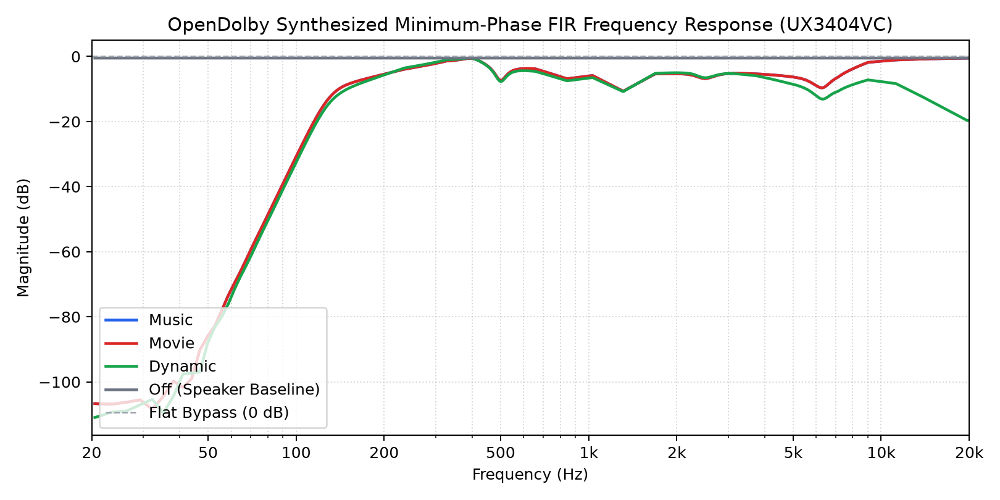

<div align="center">
  
  <h1>OpenDolby</h1>
  <p><strong>Bring OEM speaker tuning back to Linux.</strong><br/>Open-source Dolby DAX3 tuning parser &amp; zero-latency PipeWire <code>filter-chain</code> generator.</p>
  <p>
    <a href="https://github.com/Ravomi/OpenDolby/actions/workflows/ci.yml"></a>
    
    
    
  </p>
  <p><a href="#opendolby">English</a> · <a href="#简体中文">简体中文</a></p>
</div>

---

> [!WARNING]
> **Experimental / Clean-Room Notice**: OpenDolby is an independent clean-room implementation based on OEM tuning XMLs. It is **not** official Dolby software or a Dolby Atmos decoder.

## Why OpenDolby?

Laptop speakers on Linux often sound flat or tinny compared to Windows because the manufacturer's Dolby DAX3 / APO speaker tuning is not applied.

- **Not a generic EQ preset**: Directly parses the OEM's speaker-specific DAX3 XML (crossovers, biquads, and multiband curves).
- **Zero-latency PipeWire native**: Synthesizes causal minimum-phase FIR impulse responses (`.irs`) and runs natively in PipeWire `filter-chain` with optional `lsp-plugins` LV2 brickwall limiting.
- **Easy to try & revert**: One command to install, switch profiles, check status, or cleanly uninstall.

## Frequency Response & UI Preview

<div align="center">
  
</div>

<div align="center">
  
  
</div>

## Quickstart

Built and verified on **ASUS Zenbook UX3404VC** (`Realtek ALC294`, `VEN_10EC&DEV_0294&SUBSYS_10431693`).

```bash
# Run directly with uv (no manual venv or cargo needed)
git clone https://github.com/Ravomi/OpenDolby.git && cd OpenDolby
uv run python -m opendolby.cli install music

# Switch profiles (movie / dynamic / game / voice)
uv run python -m opendolby.cli install movie

# Check active installation
uv run python -m opendolby.cli status

# Uninstall and restore plain speaker output
uv run python -m opendolby.cli uninstall
```

### Use Your Own Laptop's DAX3 XML

Extract the DAX3 `.xml` from your Windows partition (`C:\Windows\System32\drivers\`) or OEM audio driver package, then pass `--xml`:

```bash
uv run python -m opendolby.cli inspect --xml /path/to/your_dax3.xml
uv run python -m opendolby.cli install music --xml /path/to/your_dax3.xml
```

## How It Works

1. **Parse DAX3 XML (`opendolby/parser.py`)**: Extracts `tuning-cp` (IEQ, GEQ, Optimizer) and `tuning-vlldp` (20-band speaker optimizer, `speaker-peq-filters` biquads/crossovers, multiband compressor, peak ceiling).
2. **Synthesize Minimum-Phase FIR (`opendolby/dsp.py`)**: Combines active curves on a dense FFT grid, converts to a causal minimum-phase `.irs` (float32 stereo WAV) via real cepstrum, and trims headroom safely below `0 dBFS`.
3. **Generate PipeWire `filter-chain` (`opendolby/pipewire.py`)**: Emits a zero-latency `builtin` convolver + optional `lsp-plugins` LV2 `limiter_stereo` targeting your hardware speaker sink.

See [docs/architecture.md](docs/architecture.md) for full DSP mapping details.

## License

Dual-licensed under **MIT OR Apache-2.0**.

---

## 简体中文

<p><strong>把本机扬声器调音带回 Linux。</strong>开源的 Dolby DAX3 调音解析器与零延迟 PipeWire <code>filter-chain</code> 生成器。</p>

- **并非通用 EQ 预设**：直接解析 Windows 驱动 XML 中的厂商扬声器专属调音（分频、双二阶滤波器、多段曲线）。
- **PipeWire 原生零延迟**：通过实倒谱合成因果最小相位 FIR 脉冲响应（`.irs`），并可选搭配 `lsp-plugins` LV2 限幅器。
- **支持自定义机型**：默认内置华硕 Zenbook UX3404VC 配置，也支持 `--xml <path>` 导入其他笔记本的 DAX3 XML。

### 快速开始

```bash
git clone https://github.com/Ravomi/OpenDolby.git && cd OpenDolby
uv run python -m opendolby.cli install music   # 安装 music 配置
uv run python -m opendolby.cli status          # 查看当前状态
uv run python -m opendolby.cli uninstall       # 卸载并恢复默认输出
```
